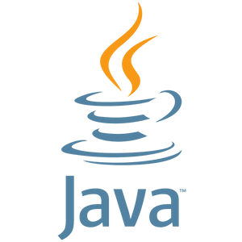

# Java desde cero

¡Bienvenido a mi guía de programación Java!

Esta web está dirigida a personas que están empezando a programar y quieren aprender los conceptos fundamentales de Java.

## ¿Qué aprenderás?

En esta guía encontrarás los siguientes temas:

- Introducción al lenguaje Java.
- Variables y tipos de datos.
- Estructuras condicionales.
- Bucles y estructuras repetitivas.

## ¿Qué es Java?

Java es un lenguaje de programación utilizado para desarrollar diferentes tipos de aplicaciones.

Una de sus características es que utiliza la programación orientada a objetos.

## Objetivo de la guía

El objetivo es explicar los conceptos básicos de Java mediante definiciones sencillas y ejemplos de código.

!!! info "Sobre esta documentación"
    Este proyecto se ha creado con MkDocs y Material for MkDocs como parte de una práctica de desarrollo web.

!!! tip "Consejo para principiantes"
    La mejor manera de aprender a programar es comprender los ejemplos y practicar modificándolos.